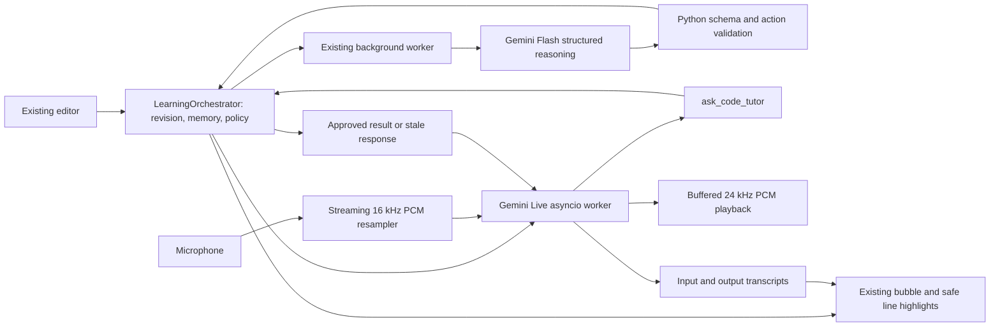

# Gemini upgrade — implementation and verification

## Diagnosis

The previous app had an editor, robot, bounded background HTTP worker, and Qt
system speech. It had no Gemini adapter, microphone capture, Live connection,
transcription, or validated shared learning state. Timer-driven checks lacked a
structured decision about whether to interrupt.

Earlier prompts alternated between fixed brevity and mandatory four-part lessons.
That could make typos overlong and lessons too terse. Local typo rules were not a C
reasoning engine. Existing User-Agent, parser and code-formatting fixes are retained.

## Architecture

Flash is the programming authority. Live routes spoken turns through ask_code_tutor.
Python accepts only that tool; no editor-write operation is exposed. Audio is not
authorized until an approved teaching action or tool response exists. Live is
instructed to speak that message naturally without adding another diagnosis.
Exact spoken semantic equivalence still depends on model instruction-following.

Initial reference preparation returns assignment/reference summaries, concepts,
flexible objective IDs and completion evidence criteria before practice opens.
Later calls receive that plan and compact learning memory. Results must pass
schema, objective-ID, line-range and disclosure checks. Old editor revisions
cannot update either UI or learning memory.

Automatic assistance is optional. Completed statements/blocks are debounced.
Background requests have a 10-second minimum interval plus cooldown, speech
awareness and duplicate suppression. The analyzer can choose stay_silent.
A timer never directly commands speech.

## Changed and new files

| File | Responsibility |
| --- | --- |
| buddy/gemini_analysis.py | Official SDK, structured results, reference understanding, action validation, bounded transient retries |
| buddy/orchestration.py | Shared learning/conversation memory, revision checks and interruption policy |
| buddy/live_voice.py | Async Live connection, analyzer tool handoff, both transcripts, interruption, bounded reconnect and resumption |
| buddy/audio_io.py | Persistent audio devices, bounded PCM buffers, high-quality streaming resampling |
| buddy/runtime_checks.py | Offline SDK-schema and packaged audio-dependency check |
| buddy/analysis.py | Extends existing Snapshot/Feedback; retains demo/compatible providers |
| buddy/window.py | Connects existing editor/buttons/bubble; adds compact Live/mute/transcript controls |
| buddy/settings.py | Gemini preset, models, voice, language, timing and separate audio consent |
| buddy/editor.py | Validated analysis highlights alongside existing bracket checks |
| main.py | Existing entry point, expanded packaged smoke test |
| requirements.txt | Pins Google SDK, Pydantic, sounddevice, NumPy and SoXR |
| scripts/build_windows.py | Includes new native dependencies and notices |
| scripts/check_gemini.py | Offline check and opt-in real-model sample scenarios |
| tests/test_gemini.py | SDK contracts, structured decisions, policy, DSP, transcripts, interruption and reconnect |
| tests/test_tutoring.py | Updated privacy expectations for new nonsecret settings |

No separate backend, replacement editor, React/TypeScript app or character rewrite.

## Verified API contracts

Checked on 17 November 2026 against official documentation. Defaults are
**gemini-3.8-flash** and **gemini-3.8-live**. They are editable because availability
and project access can change.

Flash uses genai.Client(...).models.generate_content with application/json and a
Pydantic response_json_schema. Live uses client.aio.live.connect,
send_realtime_input, send_client_content, send_tool_response and receive.

Input/output transcription, context compression and in-memory session resumption
are enabled. Unsupported 3.8 Live options such as enable_affective_dialog and
thinking-level overrides are omitted. Server VAD handles interruption.
All parts of every server event are processed, not just its first audio/text part.

## Audio design and limits

Capture is signed 16-bit mono at the default device rate. SoXR converts continuous
chunks to little-endian 16 kHz PCM. Output arrives at 24 kHz; a persistent output
stream uses that rate when supported or resamples to the device's native rate.

Queues are bounded. An interruption clears old playback and resampler state.
Editor revisions invalidate obsolete queued teaching actions and speech. Muting
clears capture packets and ends the current audio stream; stopping closes devices
and the network task. No recordings are stored.

Headphone mode permits full duplex. Speaker-safe capture gating avoids speaker
echo but sacrifices barge-in during playback. This is **not acoustic echo cancellation**.

Output transcripts can lead playback. Rows remain partial while playing and finish
after turn completion and buffer drain. Interrupted rows explicitly warn that
received text may include an unplayed ending. There is no claim of word-perfect
played-audio alignment.

Disconnections trigger at most three connection attempts with bounded backoff.
Old audio/prompts are never replayed. Session resumption is used where available;
fresh compact context is also supplied. Recent speech may need repeating.

## Configuration and privacy

Use a Google AI Studio key in the masked field or GEMINI_API_KEY before launch.
The app saves neither keys nor consent. Both code-transfer and microphone-transfer
consent are explicit for each app session. Live starts only from the learning-view
button. New exercise, provider/settings changes, Sound off and app close stop Live.
Gemini mode has no automatic system-speech fallback.

Provider payloads contain source and compact learning/conversation data after
consent; Live additionally transmits microphone audio. API costs and data policies
depend on Google and the account. Development logs contain safe failure categories.

## Verification

See VERIFICATION.md for the final executed checks and package results.

Local checks include structured reference preparation, real SDK config types,
revision safety, ranges and objective IDs, both transcripts in one event, stale
tool replies, suppression of unapproved audio, interruption buffer clearing,
bounded capture/playback, and reconnect with session resumption.

The default audio devices were opened in a muted probe. Output accepted 24 kHz;
zero capture packets were queued while muted. Synthetic DSP tests verify correct
16 kHz duration for both 44.1 and 48 kHz input.

**Not verified with a real Gemini account:** reasoning quality, audible
naturalness, STT accuracy, real-network barge-in and measured latency.
No Gemini API key was available. Mock fixtures test how the app handles those
responses; they do not prove the model can identify every mistake.

### Live acceptance plan

| Case | Expected observation |
| --- | --- |
| A: Initialized array | Progress recognized without a fabricated error |
| B: 25-second pause | Contextual decision; silence if no specific problem |
| C: Index <= array length | Targeted bounds explanation at the right line |
| D: Correct while instead of for | Alternative accepted |
| E: “Why do I need this variable?” | Flash receives current code and question; Live delivers its result |
| F: Interrupt speech with headphones | Old audio clears; new question takes precedence |
| G: English/German speech | Both transcripts visible; no duplicate rows; interruption marked partial |
| H: Correct independent work | No repetitive or timer-only speech |
| I: Network outage | UI stays usable; controlled reconnect; no stale-audio replay |

Run scripts/check_gemini.py --run-live-analysis with a locally configured key for
real Flash observations on A/C/D. Complete the other cases in the app. Do not
paste keys into reports or chat.

## Sources

- [CodeBuddy reference architecture](https://devpost.com/software/codebuddy-ea2z9c):
  two-model coordination and speech-aware analysis timing; no source was assumed.
- [Official Google Python SDK](https://googleapis.github.io/python-genai/)
- [Flash model](https://aistudio.google.com/docs/models/gemini-3.8-flash)
- [Live model](https://aistudio.google.com/docs/models/gemini-3.8-live)
- [Structured outputs](https://aistudio.google.com/docs/structured-output)
- [Live capabilities/transcription](https://aistudio.google.com/docs/live-api/capabilities)
- [Live tool calls](https://aistudio.google.com/docs/live-api/tools)
- [Live compression/resumption](https://aistudio.google.com/docs/live-api/session-management)
- [Voice configuration](https://firebase.google.com/docs/ai-logic/live-api/configuration?api=dev)
- [Streaming SoXR API](https://python-soxr.readthedocs.io/en/latest/soxr.html)
